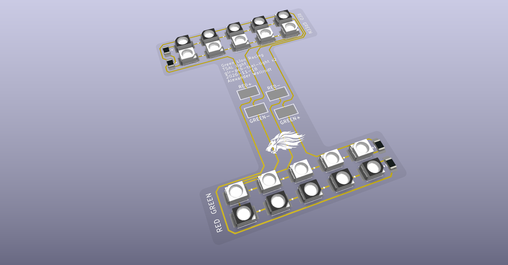

# glr-pcb-tsal-light

This is a KiCad repository for the TSAL light PCB designed by the Green Lion Racing team.

  
  

## Overview

Layout is designed for a (transparent) flex PCB to wrap around the main hoop.

Input is 24V each for red and green LEDs.

LEDs are from Würth Elektronik.
